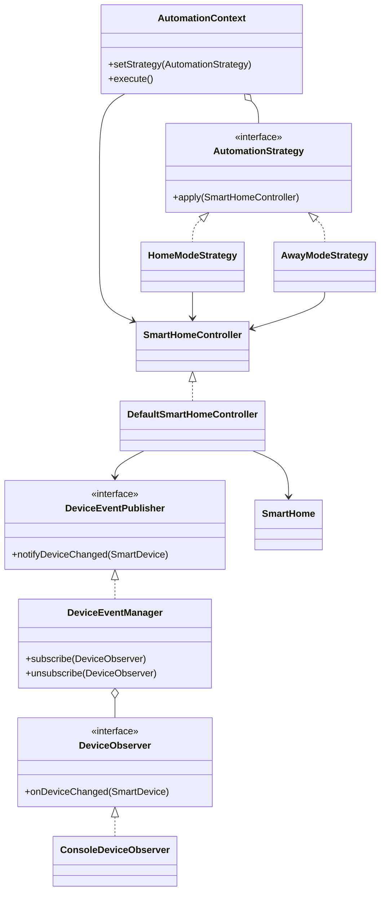

# Observer и Strategy: вклад участника

## Требования и границы работы

Из Final Project Defense Requirements: каждому студенту минимум два паттерна,
команде минимум шесть различных паттернов, интегрированных в одно приложение.
Observer и Strategy — два behavioral-паттерна данной ветки.
Factory/Builder (creational) и Adapter/Facade (structural) должны быть реализованы
и объединены из веток других участников; эта ветка не подтверждает их готовность.

Для финальной сдачи команде ещё нужны: общий отчёт PDF (Introduction, Body,
Conclusion, Further work, Java-код, скриншоты, UML), ZIP исходников, Git-репозиторий
с реальными коммитами каждого участника и индивидуальная сдача в Moodle вовремя.
В предоставленном PDF конкретная дата дедлайна не указана.
Дополнительные критерии: код 50%, отчёт 10%, защита 40%; штраф 5% за нарушение.

## Observer

DeviceEventManager — Subject, DeviceObserver — интерфейс Observer,
ConsoleDeviceObserver — ConcreteObserver. Можно подписать несколько обработчиков,
удалить подписку, повторная подписка того же объекта не создаёт дубль.
DefaultSmartHomeController вызывает существующий DeviceEventPublisher после
реального изменения состояния. Повторный turnOn/turnOff не публикует событие.
Коллекция подписчиков копируется перед уведомлением, поэтому обработчик может
отписаться прямо во время вызова. Все подписчики получают уведомление даже при
RuntimeException одного из них; затем выбрасывается общая ошибка с suppressed
исключениями. Состояние устройства к этому моменту уже изменено.

Текущая версия синхронная, для одного потока. Передаётся ссылка на устройство,
не исторический снимок. Изменения напрямую через SmartDevice и изменение
температуры не публикуются автоматически: для отслеживания питания следует
использовать контроллер. Реальные датчики движения/температуры — дальнейшее развитие.

## Strategy

AutomationStrategy — Strategy, HomeModeStrategy/AwayModeStrategy — ConcreteStrategy,
AutomationContext — Context. Home включает все устройства, Away выключает их.
setStrategy заменяет алгоритм во время работы. Новый режим реализует интерфейс
без изменения Context; стратегии используют SmartHomeController и не знают
конкретных классов устройств. Это также точка интеграции с будущим Facade.

Связь паттернов: Context -> Strategy -> Controller -> Publisher -> Observers.
При ошибке выполнения режим прекращается; транзакционный откат не предусмотрен.

## Clean Code / SOLID / KISS / DRY

- SRP: управление устройствами, подписки и выбор режима разделены.
- OCP: новые наблюдатели и режимы добавляются отдельными реализациями.
- LSP: стратегии и наблюдатели используются через их контракты.
- ISP: небольшие интерфейсы без лишних обязанностей.
- DIP: контроллер зависит от DeviceEventPublisher, стратегии от SmartHomeController.
- DRY: единая setPower содержит проверку состояния и публикацию события.
- KISS: обычные Java-интерфейсы и синхронные вызовы без фреймворков.

## Запуск и проверка

JDK 21+, Maven 3.9+:

```sh
mvn test
mvn compile
java -cp target/classes com.smarthome.Main
```

Демо показывает Home, смену на Away и отписку наблюдателя.
JUnit проверяет интеграцию обоих паттернов, отсутствие лишних уведомлений,
отписку, ошибки подписчиков, расширение алгоритма, пустой дом и неверный ID.

## UML классов



## Вопросы для защиты

Observer отвечает за уведомление нескольких зависимых объектов об изменении.
Strategy инкапсулирует взаимозаменяемые алгоритмы. Их отличие: подписка и рассылка
против выбора алгоритма. Полиморфизм проявляется в вызовах apply/onDeviceChanged
через интерфейсы; инкапсуляция скрывает список подписчиков и текущую стратегию;
композиция позволяет подставлять зависимости без наследования контроллера.
