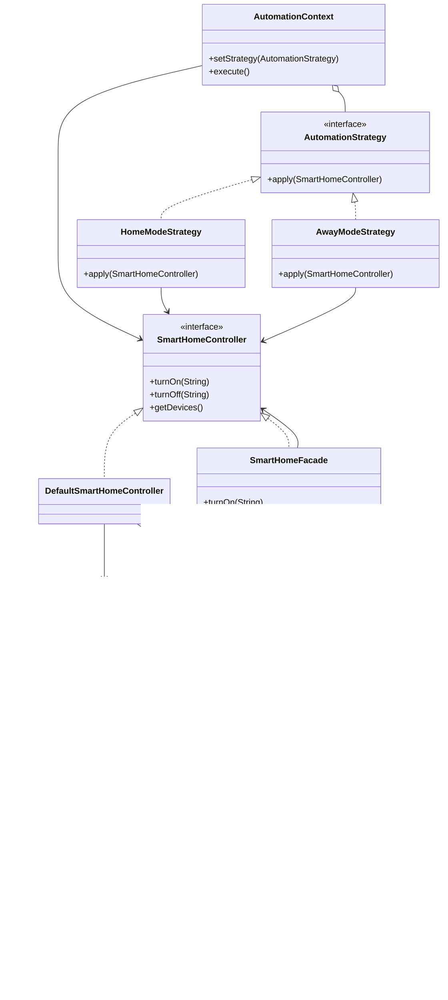

# Observer and Strategy: Contributor Implementation and Integration

## 1. Project Requirements and Scope

According to the Final Project Defense Requirements, each team member must implement at least two design patterns. The team must integrate at least six distinct design patterns into one cohesive application.

The Smart Home Automation project implements six design patterns:

- **Creational Patterns:** Factory Method and Builder.
- **Structural Patterns:** Adapter and Facade.
- **Behavioral Patterns:** Observer and Strategy.

This document focuses on the Observer and Strategy implementations, their integration with the other components, and their responsibilities within the completed project.

All six design patterns are integrated into the application. The `Main.java` class demonstrates device creation, smart home configuration, legacy device adaptation, centralized device control, event notifications, and runtime strategy switching.

### Final Submission Requirements

The project must include:

- A PDF report containing an Introduction, Body, Conclusion, and Further Work section.
- Relevant Java source code.
- Screenshots demonstrating the application's functionality.
- UML diagrams showing the system architecture and design patterns.
- A ZIP archive containing the project source code.
- A final defense in front of the instructor or evaluation committee.

The team must submit the required report and source code through Moodle.

The provided Final Project Defense Requirements document does not specify an exact submission deadline, grading percentages, or penalty amounts. Any additional assessment criteria must be verified against the separate course instructions.

## 2. Observer Design Pattern

### Purpose

The Observer pattern establishes a one-to-many relationship between an event publisher and its subscribers.

When a device's power state changes through the controller, subscribed observers receive a notification.

### Implementation

The Observer pattern consists of the following components:

- `DeviceEventPublisher` — interface for publishing device change events.
- `DeviceObserver` — Observer interface defining the notification method.
- `DeviceEventManager` — concrete event publisher responsible for managing subscriptions and delivering notifications.
- `ConsoleDeviceObserver` — concrete Observer that displays device status changes in the console.
- `DefaultSmartHomeController` — controller responsible for changing device states and publishing events.

### How It Works

1. An observer subscribes to `DeviceEventManager`.
2. A device is turned on or off through `DefaultSmartHomeController`.
3. The controller checks the device's current power state.
4. If the state needs to change, the controller updates the device.
5. The controller calls `notifyDeviceChanged()` on the event publisher.
6. `DeviceEventManager` notifies all subscribed observers.
7. `ConsoleDeviceObserver` displays the updated device status.

### Observer Features

- Multiple observers can subscribe to the same event publisher.
- An observer can unsubscribe when notifications are no longer required.
- Repeated subscription of the same observer does not create duplicate subscriptions.
- Repeated `turnOn()` or `turnOff()` operations do not generate unnecessary events when the device is already in the requested state.
- The subscriber collection is copied before notification delivery, allowing an observer to unsubscribe during a callback.
- If one observer throws a `RuntimeException`, the remaining observers are still notified.
- Observer failures are collected as suppressed exceptions and reported through an `IllegalStateException`.
- The device state may already have changed before an observer exception is reported.

### Current Limitations

The implementation uses synchronous notifications and is designed for single-threaded operation.

Observers receive references to device objects rather than historical snapshots of their previous states.

Direct device modifications through `SmartDevice` do not automatically generate notifications.

Changing the thermostat temperature does not currently publish a separate event.

For monitored power-state changes, devices should be controlled through `SmartHomeController`.

Integration with real temperature sensors, motion sensors, and asynchronous event processing can be considered as future improvements.

## 3. Strategy Design Pattern

### Purpose

The Strategy pattern defines a family of interchangeable algorithms and allows the application to switch between them at runtime.

In this project, strategies represent different smart home automation modes.

### Implementation

The Strategy pattern consists of the following components:

- `AutomationStrategy` — Strategy interface defining the automation algorithm.
- `HomeModeStrategy` — concrete Strategy that turns on all devices.
- `AwayModeStrategy` — concrete Strategy that turns off all devices.
- `AutomationContext` — Context that stores and executes the selected Strategy.

### How It Works

1. `AutomationContext` receives a `SmartHomeController` and an initial Strategy.
2. The selected Strategy is stored inside the Context.
3. The `execute()` method calls the current Strategy's `apply()` method.
4. The Strategy performs its operations through `SmartHomeController`.
5. The `setStrategy()` method allows the application to replace the active Strategy during runtime.

### Home Mode

`HomeModeStrategy` activates all devices registered in the smart home.

It calls `turnOn()` through the controller for each device.

### Away Mode

`AwayModeStrategy` deactivates all devices registered in the smart home.

It calls `turnOff()` through the controller for each device.

### Extensibility

New automation modes can be introduced by implementing the `AutomationStrategy` interface.

For example, a future Energy Saving Mode could reduce the number of active devices.

The existing `AutomationContext` does not need to be modified when a new Strategy is added.

Strategies depend on the `SmartHomeController` abstraction rather than specific device classes.

## 4. Observer and Strategy Integration

Observer and Strategy are integrated through the smart home controller.

The completed application also uses `SmartHomeFacade`, which implements the `SmartHomeController` interface and delegates device operations to another controller.

### Integration Flow

`AutomationContext → AutomationStrategy → SmartHomeFacade → DefaultSmartHomeController → DeviceEventPublisher → DeviceObserver`

### Execution Process

1. The application creates devices using Factory Method.
2. The Builder assembles the devices into a `SmartHome`.
3. The Adapter allows a legacy lamp to operate through the common device interface.
4. The Facade provides simplified device management.
5. `AutomationContext` executes the selected automation Strategy.
6. The Strategy calls the controller to change device states.
7. The underlying controller publishes power-state change events.
8. Subscribed observers receive notifications.

### Error Handling

If an automation operation throws an exception, the current strategy execution stops.

The implementation does not provide transactional rollback. Device changes completed before the exception remain applied.

## 5. Clean Code and Design Principles

The implementation follows relevant SOLID, KISS, and DRY principles.

### Single Responsibility Principle (SRP)

Responsibilities are separated between different components.

- `DeviceEventManager` manages event subscriptions and notifications.
- `DefaultSmartHomeController` handles device power-state changes.
- `AutomationContext` manages the current automation Strategy.

### Open/Closed Principle (OCP)

New observers and automation strategies can be introduced without modifying the existing Context or event publisher.

### Liskov Substitution Principle (LSP)

Concrete strategies and observers are used through their corresponding interfaces.

Implementations can be substituted as long as they respect their interface contracts.

### Interface Segregation Principle (ISP)

The system uses focused interfaces with specific responsibilities.

Examples include `AutomationStrategy`, `DeviceObserver`, and `DeviceEventPublisher`.

### Dependency Inversion Principle (DIP)

Higher-level components depend on abstractions rather than directly depending on concrete implementations.

- `DefaultSmartHomeController` depends on `DeviceEventPublisher`.
- Automation strategies depend on `SmartHomeController`.
- `AutomationContext` depends on `AutomationStrategy`.

### Don't Repeat Yourself (DRY)

The `setPower()` method centralizes device power-state checks, state changes, and event publication.

This avoids duplicating the same logic in `turnOn()` and `turnOff()`.

### Keep It Simple, Stupid (KISS)

The implementation uses standard Java interfaces, straightforward class relationships, and synchronous method calls without unnecessary frameworks.

## 6. Running and Testing the Project

### Requirements

- JDK 21 or later.
- Maven 3.9 or later recommended.

### Commands

Run the automated tests:

```sh
mvn test
```

Compile the project:

```sh
mvn compile
```

Run the main application:

```sh
java -cp target/classes com.smarthome.Main
```

### Application Demonstration

The `Main.java` class demonstrates:

1. Creating smart devices using Factory Method.
2. Building a Smart Home using Builder.
3. Integrating a legacy lamp using Adapter.
4. Managing devices through Facade.
5. Notifying subscribers through Observer.
6. Activating Home Mode using Strategy.
7. Switching to Away Mode during runtime.
8. Unsubscribing an observer and continuing device operations.

### JUnit Testing

The project contains JUnit tests covering the design patterns and their integration.

Observer and Strategy tests verify:

- Runtime strategy switching.
- Correct device activation and deactivation.
- Observer notifications after device power-state changes.
- Prevention of duplicate notifications.
- Observer subscription and unsubscription.
- Unsubscribing during a notification callback.
- Handling exceptions thrown by observers.
- Implementing custom automation strategies.
- Handling an empty smart home.
- Rejecting unknown device IDs.
- Rejecting null dependencies.

Additional tests cover device construction, Factory Method, Builder, and integration between other patterns.

## 7. UML Class Diagram

The following UML diagram illustrates the Observer and Strategy components and their integration with the smart home controller and Facade.



Additional UML diagrams are available in `docs/uml/`:

- `factory-builder-uml.png`
- `adapter-facade-uml.png`
- `observer-strategy-uml.png`
- `smart-home-full-uml.png`

## 8. Design Pattern Defense Questions

### What is the purpose of the Observer pattern?

The Observer pattern notifies multiple subscribed objects when a relevant event occurs.

### What is the purpose of the Strategy pattern?

The Strategy pattern encapsulates interchangeable algorithms and allows them to be selected or replaced at runtime.

### What is the difference between Observer and Strategy?

Observer focuses on subscriptions and event notifications.

Strategy focuses on selecting and executing interchangeable algorithms.

### How are Observer and Strategy connected in this project?

Strategies control devices through `SmartHomeController`.

The controller publishes notifications when device power states change.

Observers receive and process these notifications.

### Where is polymorphism used?

Polymorphism is used when calling `apply()` and `onDeviceChanged()` through their interfaces.

### Where is encapsulation used?

`DeviceEventManager` encapsulates its collection of subscribers.

`AutomationContext` encapsulates the currently selected Strategy.

### Where is composition used?

The Context receives a Strategy object, the controller receives an event publisher, and the Facade receives a controller.

These dependencies are combined through composition rather than relying on inheritance between their implementations.

## 9. Module Structure

The Observer and Strategy patterns are implemented in the following project structure:

```text
src/main/java/com/smarthome/
├── device/
│   ├── SmartDevice.java
│   ├── SmartLight.java
│   └── Thermostat.java
├── events/
│   └── DeviceEventPublisher.java
├── patterns/
│   ├── adapter/
│   │   ├── LampAdapter.java
│   │   └── LegacyLamp.java
│   ├── builder/
│   │   └── SmartHomeBuilder.java
│   ├── control/
│   │   ├── SmartHomeController.java
│   │   └── DefaultSmartHomeController.java
│   ├── facade/
│   │   └── SmartHomeFacade.java
│   ├── factory/
│   │   ├── DeviceFactory.java
│   │   ├── SmartLightFactory.java
│   │   └── ThermostatFactory.java
│   ├── observer/
│   │   ├── DeviceObserver.java
│   │   ├── DeviceEventManager.java
│   │   └── ConsoleDeviceObserver.java
│   └── strategy/
│       ├── AutomationStrategy.java
│       ├── AutomationContext.java
│       ├── HomeModeStrategy.java
│       └── AwayModeStrategy.java
├── Main.java
└── SmartHome.java
```

The six implemented design patterns are integrated and demonstrated through the main application.

## 10. Conclusion and Further Work

The Observer and Strategy patterns provide event-driven notifications and interchangeable automation modes within the Smart Home Automation system.

Together with Factory Method, Builder, Adapter, and Facade, these patterns form a cohesive Java application demonstrating object-oriented programming and software design principles.

The current implementation supports smart device creation, centralized control, legacy device integration, observer notifications, and runtime switching between Home and Away modes.

Potential future improvements include:

- Integration with real smart home sensors.
- Temperature-change notifications.
- Motion detection events.
- Additional automation strategies.
- A graphical user interface.
- Asynchronous event processing.
- More comprehensive automated tests.

These improvements are optional extensions and are not presented as features of the current implementation.